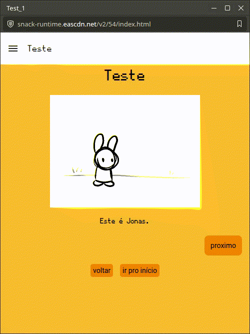
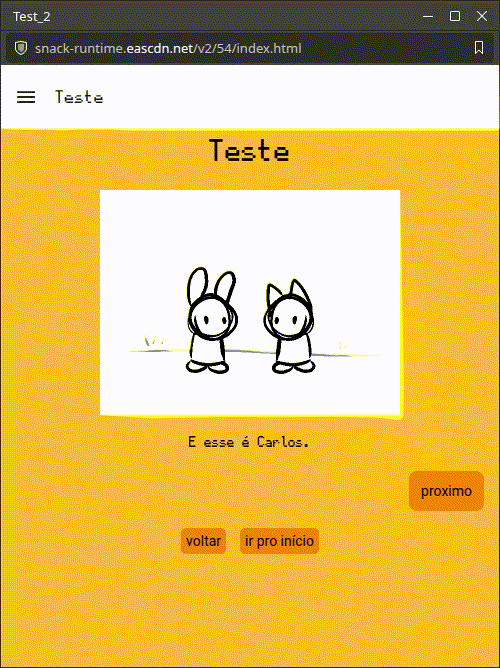
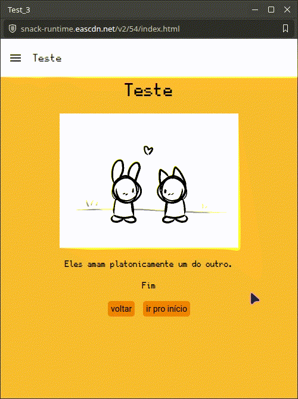

# Um Sonho Sem Nome

## Visão Geral
Este projeto consiste em uma webcomic, ou um quadrinho online, estruturado em React-Native que tem propositos em entreterimento

## Requisitos
- Mínimo de 6 telas distintas
- Uso React Navigation (stack, tab ou drawer)
- Implementação de imagens
- Aplicar Estilo e UX
  - Layout orgabnizado
  - Alinhamento Consistente
  - Espaçamento adequado entre elementos
  - Feedback ao usuário
- Implementação do Firebase (banco de dados)
  - Salvar
  - Recuperar
  - Atualizar
  - Remover
- Uso de atuatores

## Dependências Usadas

### React-Native
Framework do projeto

### React 
Uso de useState para variaveis e useEffect para executar funções quando uma tela é montada

### Firebase
Banco de dados

### @react-navigation/native
Navegações entre telas

### @react-navigation/stack
Navegar telas dentro de telas

### @react-navigation/drawer
Navegar telas em um menu lateral

### @expo-font & expo-splash-screen
expo-font permite o uso de fontes costumizadas enquanto expo-splash-screen me permitiu esconder a tela de splash

Referência usada: [https://docs.expo.dev/develop/user-interface/fonts/](https://docs.expo.dev/develop/user-interface/fonts/)

## Funcionalidades

### Proximo
Move para a proxima página do quadrinho

### Voltar
Move para a página anterior do quadrinho (caso estiver na primeira página do quadrinho, volta para a tela de home)

### Ir pro inicio
Move para a primeira página do quadrinho

### Salvar
Cria ou substitui dados do quadrinho (o nome da personagem e a onde que parou no quadrinho)

### Deletar
Deleta os dados do quadrinho

## Instalação e Execução
- Abrir o projeto por meio do terminal
- "npm start" ou "npx expo start"

## Minha Experiência
Trabalhar com react-native não foi muito diferente que fazer projetos em html mas desta vez é mais simples de programar em JavaScript. 

O meu tema do projeto não é algo que revoluciona ou contribuiu de uma maneira direta mas é algo único que pensei em fazer entre as pessoas que estavam fazendo os seus projetos.

Uma das maiores dificuldades foi tentar utilizar dados que estavam armazenados no banco de dados do Firebase com intuito de utilizar esses dados como variáveis.

Uma outra dificuldade foi tentar realizar este projeto no editor de código VSCode pois dava erros complexos de web build e na utilização de depêndencias, tanto que optei por usar Snack para o desenvolvimento do meu projeto.

Mesmo dessas dificuldades, eu espero que no futuro eu possa utilizar esse framework para projetos futuros e aprender melhor o react-native para minha vida profissional.

## Links
Repositório no GitHub: [https://github.com/nishihtml/yellow](https://github.com/nishihtml/yellow)
Expo Snack: [https://github.com/nishihtml/yellow](https://snack.expo.dev/@nishijsx/um-sonho-sem-nome?platform=web)
